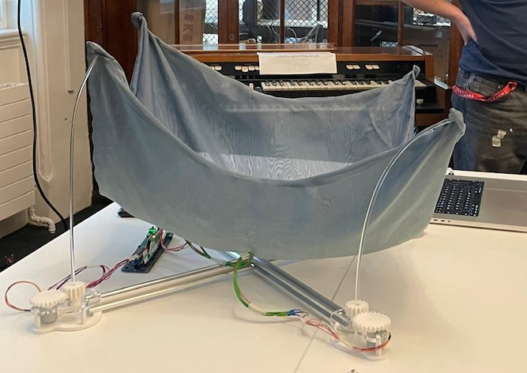

# IDE Cyber Physical Systems Group 5 - 2026

Group members: Saskia Lampe, Katie Han and Josh Hill

## Concept:

Our CPS submission is an interactive sculpture that acts somewhat abstractly like a shy cat. The person interracting with it needs first to let the sculpture build trust with you by moving slowly, and then eventually when enough trust is built, it begins to mirror the participant's movement (X and Y of each wrist correlate to one stepper each). If at any point you move too quickly too much, the sculpture will lose trust in you, close up, and you will have to start the process again.

A blue organza fabric core is suspended by four rotating arms, creating organic movement responding to the participant's pace and body position. This design and interaction draws on the practice of tai chi: a still center, a slow-moving periphery, and a force that comes from softness rather than sudden motion.

## Electronic Schematic

## Mechanical Assembly

The mechanical assembly we decided to use to make gear up the stepper motors to get faster speeds out of them. This was important for our startle response in the sculpture to feel fast enough that it was scared and not just returning to home.

**Components:**

- 4 stepper motors
- acrylic rods
- blue organza
- base frame made of 80 20
- Arduino

## Software Design

### `python_ShyCatFullPipe.py`

- Captures video from the webcam and detects whether a person is present.

- Tracks six body landmarks: shoulders, wrists and hips.

- Smooths tracking data to reduce jitter.

- Calculates positions, speeds, movement variability and acceleration.

- Normalises measurements to make them less sensitive to camera distance.

- Sends 12 bits of information to Wekinator and to Processing.

### `wek_ShyCatFullPipe.wekproj`

- Fast, erratic and "aggressive" movements (as communicated by the 12 Python outputs) means low Engagement high Threat.

- Slow, gentle and considered movements means low threat, high engagement.

- This was the training program for Wekinator.

### `processing_ShyCatFullPipe.pde`

- Receives threat and engagement predictions from Wekinator.

- Receives wrist positions and other tracking information directly from Python.

- Calculates internal states including trust, fear, startle and mimicking strength.

  - (You can adjust the rates that these change at in the code)

- Determines whether the sculpture should hide, gradually open, wander while idle or mimic the person's wrists.

- Converts these behaviours into target positions for all four motors.

- Displays a control panel showing the sculpture's internal state and commanded motor positions.

- Handles keyboard testing, manual motor homing and communication with the Arduino.

### `arduino_ShyCatFulPipe.ino`

- Receives four target positions from Processing via OSC.

- Controls the stepper motors through the driver boards.

- Uses the <AccelStepper.h> library to control motor speed, acceleration and position.

- Allows multiple motors to move independently and simultaneously (this is why AccelStepper was used and not just Stepper).

### How to run

This code has only been tested to work on Mac.

1. Make a local copy of the entire folder ShyCatFullPipe.

2. In `ShyCatFullPipe` create a Python virtual environment in that folder using: `python -m venv .venv` and then activate using: `source .venv/bin/activate`.

3. Install the dependencies using: `python -m pip install -r requirements.txt`

4. Navigate to the Python folder, and then run `python_ShyCatFullPipe.py` with: `python python_ShyCatFullPipe.py`. The camera should appear.

5. Start Wekinator and open `wek_ShyCatFullPipe.wekproj` and run. You should see that the values of threat and engagement change depending on your movement.

6. Ensure `arduino_ShyCatFullPipe.ino` is uploaded to your controller with the system working correctly. (refer to the unit tests if it isnt.) and that the arduino is connected to the computer and the power board is connected to the power supply.

7. Run `processing_ShyCatFullPipe.pde`. On first run you will need to consult the list of ports it initally prints in the Processing terminal, find the one your board is and change it in the Processing code (line 11). The script will wait for you to home each stepper before running the live part.

   Homing Procedure:

   1. Press B to connect to Arduino.

   2. Use A and D to start the motor A turning either way.

   3. When at the desired angle press S to stop.

   4. Press N to save that position and move on to the next stepper. 

   5. Return to step 2 until all 4 steppers are homed.

   6. once all 4 are homed, S becomes the arming/disarming button to turn on signal to the arduino. Press once ready to begin live movement.

8. With all 3 scripts and Wekinator running, refer to the display in Processing to switch between live and test mode and wich keys to press.

9. Enjoy! Note: the Wekinator is trained with VERY slow movement, so if you want some faster movement to be less scary, add more training to it.

### System Limitations

#### Homing of the steppers

At the moment the steppers are manually homed at the beginning of each use. This is fine whilst the torque on the motors is low but with different or larger fabrics this may cause skipping of steps and the home location to be lost. This could be fixed with some sort of hard wired switch in the system to allow accurate homing during normal operation.

#### Power constraints and stepper speeds

5V being the power budget limited our ability to make something move fast and accurately and with high torque. We would consider using larger stepper motors like NEMA 17s if we had no power constraints. 

This may allow for us to have an almost instantaneous feedback to the participant.

#### Tracking

The system only mimics both wrists X and Y. Whilst interaction is still enjoyable, more time may need to be spent on dialing in the interaction language, bringing it probably more in line with the Tai Chi aspect.
