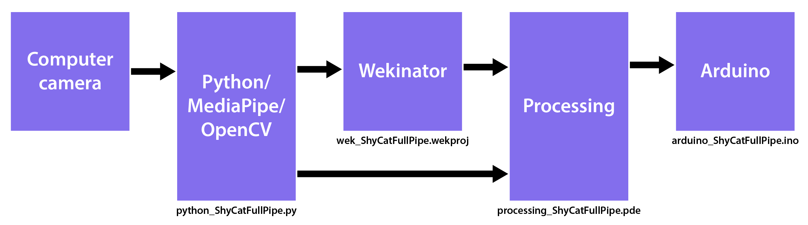

# IDE Cyber Physical Systems Group 5 - 2026

Group members: Saskia Lampe, Katie Han and Josh Hill


##### *[Fig.1 & 1.5 ] 'Shy Cat' Interactive Sculpture*

&nbsp;

## Concept:

Our CPS submission is an interactive sculpture that behaves similarly to a shy cat. To interact, the user must 'build trust' with the sculpture by moving slowly, and 'Shy Cat' will gradually begin to respond. Eventually, when enough trust has been built, the sculpture begins to mirror the participant's movement. If at any point, the participant moves too harshly, the sculpture will lose trust, and close up.


##### *[Fig.2 ] 'Shy Cat' Material Testing and Iteration*

&nbsp;

## Aesthetic and Conceptual Threads:

Shy Cat is built from a square of organza fabric suspended between curved spokes atop four stepper motors. As the user moves, the motors gently begin to correspond to the participant's pace and body position. 

Both the design and interaction draw on the practice of tai chi: a still center, a slow-moving periphery, and a force that comes from softness rather than sudden motion.

---
## Components and Parts:

|Part |Specification | Quantity|
|:---|:---|:---|
|Arduino Nano Every|  |1
|Stepper Motors | 28BYJ-48 | 4 
|Acrylic rods | 5mm| 4 
|Organza Fabric| approx. 30x30mm | 1 
|T-slot Extruded Aluminium| 590mm | 2 
|M3 Bolts| 12mm| 8 |
|M3 Bolts| 8mm| 8 |
|M3 Nuts | | 16 |

&nbsp;
## Electronic Schematic


##### *[Fig.3 ] Electronic Schematic*


## Mechanical Assembly


##### *[Fig.4 ] The Mechanical Assembly*

&nbsp;

Due to the 28BYJ-48's relatively slow RPM (topping at at 16rpm for our application), we decided to gear up the final assembly. This was important for 'Shy Cat's' startle response, as it gave us greater speed flexibility despite the slow rotation of our steppers. 

## Software Design


##### *[Fig.5 ] 'Shy Cat' Software Pipe Line*

### `python_ShyCatFullPipe.py`

- Captures video from the webcam and detects whether a person is present.

- Tracks six body landmarks: shoulders, wrists and hips.

- Smooths tracking data to reduce jitter.

- Calculates positions, speeds, movement variability and acceleration.

- Normalises measurements to make them less sensitive to camera distance.

- Sends 12 bits of information to Wekinator and to Processing.

This code was written by Josh Hill with **a lot** guidance, technical help and debugging from ChatGPT.

### `wek_ShyCatFullPipe.wekproj`

- Fast, erratic and "aggressive" movements (as communicated by the 12 Python outputs) means low Engagement high Threat.

- Slow, gentle and considered movements means low threat, high engagement.

- Threat and Engagement are two different regression models. Regression was chosen allow for a range of threats and engagements; not just off and on. 


##### *[Fig.6] Wekinator Interface*  

### `processing_ShyCatFullPipe.pde`

- Receives threat and engagement predictions from Wekinator.

- Receives wrist positions and other tracking information directly from Python.

- Calculates internal states including trust, fear, startle and mimicking strength.

  - (You can adjust the rates that these change at in the code)

- Determines whether the sculpture should hide, gradually open, wander while idle or mimic the person's wrists.

- Converts these behaviours into target positions for all four motors.

- Displays a control panel showing the sculpture's internal state and commanded motor positions.

- Handles keyboard testing, manual motor homing and communication with the Arduino.

This code was written by Josh Hill with **a lot** guidance, technical help and debugging from ChatGPT.

### `arduino_ShyCatFulPipe.ino`

- Receives four target positions from Processing via OSC.

- Controls the stepper motors through the driver boards.

- Uses the <AccelStepper.h> library to control motor speed, acceleration and position.

- Allows multiple motors to move independently and simultaneously (this is why AccelStepper was used and not just Stepper).

This code was written by Josh Hill with guidance, technical help and debugging from ChatGPT.

### How to run

This code has only been tested to work on Mac.

1. Make a local copy of the directory `ShyCatFullPipe` .

2. Within `ShyCatFullPipe`, create a Python virtual environment:

```
python -m venv .venv
```
activate the environment: 
```
source .venv/bin/activate
```

3. Install the dependencies using: 

```
python -m pip install -r requirements.txt
```

4. Navigate to the Python folder, and run

```
python python_ShyCatFullPipe.py
``` 
 
 The camera should appear.

5. Start Wekinator and open `wek_ShyCatFullPipe.wekproj` and run. You should see that the values of threat and engagement change depending on your movement.

6. Ensure `arduino_ShyCatFullPipe.ino` is uploaded to your controller with the system working correctly. (refer to the unit tests if it isnt.) and that the arduino is connected to the computer and the power board is connected to the power supply.

7. Run `processing_ShyCatFullPipe.pde`. On first run you will need to consult the list of ports initally printed in the Processing terminal. Find which port your arduino board communicates through and change it in the Processing code (line 11). The script will wait for you to home each stepper before running the live part.

##   Homing Procedure:

   1. Press B to connect to Arduino.

   2. Use A and D to start the motor A turning either way.

   3. When at the desired angle press S to stop.

   4. Press N to save that position and move on to the next stepper. 

   5. Return to step 2 until all 4 steppers are homed.

   6. once all 4 are homed, S becomes the arming/disarming button to turn on signal to the arduino. Press once ready to begin live movement.

8. With all 3 scripts and Wekinator running, refer to the display in Processing to switch between live and test mode and wich keys to press.

9. Enjoy! Note: the Wekinator is trained with VERY slow movement, so if you want some faster movement to be less scary, add more training to it.

## System Limitations
---
###  Homing of the steppers

##### At the moment the steppers are manually homed at the beginning of each use. This is fine whilst the torque on the motors is low but with different or larger fabrics this may cause skipping of steps and the home location to be lost. This could be fixed with some sort of hard wired switch in the system to allow accurate homing during normal operation.

---

### Power constraints and stepper speeds

##### 5V being the power budget limited our ability to make something move fast and accurately and with high torque. We would consider using larger stepper motors like NEMA 17s if we had no power constraints. 
##### This may allow for us to have an almost instantaneous feedback to the participant.
---
### Tracking

##### The system only mimics both wrists X and Y. Whilst interaction is still enjoyable, more time may need to be spent on dialing in the interaction language, bringing it probably more in line with the Tai Chi aspect.
---
### Machine Learning

##### The training that was done is on a small number of people and as such, lacks broader realism. The way one person would move in a calm or agitated way is different to another. Adding more people to the data would help make the model more capable at recognising these altered states in a wider range of participants.
